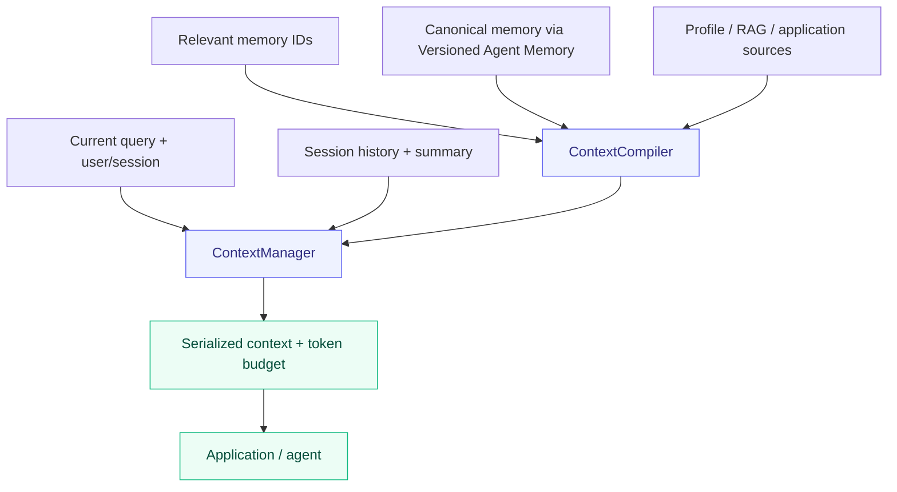

<div align="center">

# Agent Context Builder

Formerly **ContextKit**. Repository branding has changed; Python package names, imports and CLI commands remain compatible.

**English · [简体中文](README.zh-CN.md)**

### Sessions in order. Context within budget.

Session and context orchestration for stateful applications.

[](pyproject.toml) [](CHANGELOG.md) [](docs/validation.md) [](LICENSE) [](#limitations) [](https://github.com/Elyon0517/agent-context-builder/stargazers)

**Find this useful? [Give it a star ⭐](https://github.com/Elyon0517/agent-context-builder)**

[Architecture](docs/architecture.md) · [Examples](examples) · [Validation](docs/validation.md) · [Contributing](CONTRIBUTING.md)

</div>



## Three independent components

| Repository | Responsibility |
| --- | --- |
| [Versioned Agent Memory](https://github.com/Elyon0517/versioned-agent-memory) | Long-term memory, storage, retrieval, session history and summary state |
| **Agent Context Builder** | Session context assembly, source arbitration and budgeting |
| [Agent Strategy Eval](https://github.com/Elyon0517/agent-strategy-eval) | Independent experiments and strategy evaluation |

Agent Context Builder 0.2 delegates its memory kernel to Versioned Agent Memory rather than maintaining a duplicate. Existing `contextkit.MemoryEngine`, models and storage adapter imports remain compatibility exports. Agent Context Builder owns orchestration; it does not execute models or tools.

## Quick start

Python 3.11+. Git installation resolves the pinned Versioned Agent Memory release. Packages are currently distributed through GitHub, not PyPI.

```bash
pip install "contextkit-state @ git+https://github.com/Elyon0517/agent-context-builder.git@v0.2.0"
```

```python
from agent_memory_kit import Message, Scope, SessionMemory
from contextkit import ContextCompiler, ContextManager
from contextkit.adapters import InMemoryStore

scope = Scope("demo", "user-1")
sessions = SessionMemory()
sessions.append(scope, "chat-1", Message("m1", "user", "Plan dinner"))
manager = ContextManager(
    ContextCompiler(InMemoryStore()), sessions, count_tokens=len
)  # Demonstration character counter.
context = manager.build(
    scope, session_id="chat-1", query="Suggest a menu", max_tokens=2000, reserved_tokens=300
)
print(context.render())
```

Supply a model tokenizer instead of `len` for actual token budgeting. The count includes the complete serialized envelope; reserve space for output, tools and prompt material added by your application.

## Capabilities

| Capability | Behavior |
| --- | --- |
| Session context | Combine a summary and messages after its coverage boundary |
| Source authority | Resolve conflicting profile/application/RAG facts with declared priorities |
| Failure semantics | Failed higher-authority sources block weaker facts; absent sources allow fallback |
| Retrieval bridge | Optional `retrieve_memory_ids(scope, query)` callback selects IDs; compile re-reads canonical active records |
| Budgeting | Apply both character and caller-supplied token limits without truncating records |
| Provenance | Preserve source revisions, evidence, omission counts and content-addressed snapshots |
| Cache | Optional Redis cache; canonical storage remains the authority |

Without a retrieval callback, all active canonical memories are considered. RAG/profile integrations use `ContextSource`, rather than assuming a particular database or model provider. The callback's ranking is not preserved: selected memories use compiler ordering (user corrections, confidence, ID).

## Examples

- [Session and context assembly](examples/session_context.py)
- [Source authority and failure behavior](examples/source_authority.py)
- [Compatibility memory example](examples/support_memory.py)
- [Vector retrieval](examples/vector_recall.py)
- [MongoDB and Redis](examples/mongo_redis.py)

## Limitations

Early alpha, synchronous interfaces. Session storage is currently process-local. There is no built-in model call, agent execution, tool lifecycle or tokenizer. Sources are read separately, without a transaction across providers; an already returned snapshot cannot be revoked. `ContextCompiler` uses characters; `ContextManager` additionally uses your token counter.

On overflow the manager removes summary first, then oldest recent messages, lower-priority memories, and facts. Messages already covered by a summary are not restored if the summary is omitted. Query and structural envelope are never truncated; if those alone exceed the budget, `ContextBudgetExceeded` is raised. Caller-added prompt/tool text must be accounted for via reservations. Memory ranking/expiry/persistence limits belong to [Versioned Agent Memory](https://github.com/Elyon0517/versioned-agent-memory).

## Development

```bash
python -m venv .venv
source .venv/bin/activate
pip install -e '.[dev,mongo,redis]'
pytest -q
ruff check .
ruff format --check .
mypy
```

The default suite skips three live service tests. [Validation](docs/validation.md) explains the isolated MongoDB/Redis checks and their limits.

## License

[MIT](LICENSE) © Elyon Li
