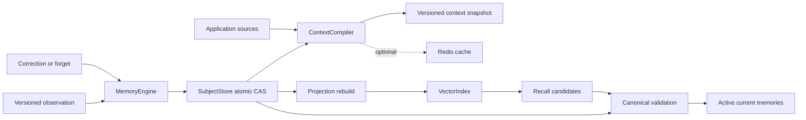

# ContextKit

Evidence-backed memory and context snapshots for stateful applications.

ContextKit keeps application observations, user corrections, and current context consistent across interactions. It is a small Python library with a dependency-free core, optional MongoDB storage and Redis caching, and a replaceable vector index contract.

**Status:** early alpha, Python 3.11+. No model API key or external service is needed for the examples. The distribution is named `contextkit-state`; the import is `contextkit`. Install from this repository; no package-index release is assumed.

## The problem

A support assistant remembers that a customer prefers short explanations. The customer corrects it. A background process later redelivers an old observation. Another process still has the old embedding. Which preference should the next interaction use?

Storing conversation history does not settle that question. An application also needs source versions, user override rules, revocation, and a fresh view of canonical state.

ContextKit provides:

- Scoped memory: every operation requires both a tenant and a subject.
- Evidence references and source versions for each observation.
- Idempotent events, stale-source rejection, and explicit identity conflicts.
- User corrections protected from subsequent inferred updates.
- Forget tombstones that block source replay and clear canonical content.
- Atomic revision-guarded updates to memory, receipts, and operation records.
- Fresh context snapshots with source authority, explicit absent/failed states, resource scope, and whole-record character budgeting.
- Vector retrieval that checks every candidate against canonical ownership, status, and memory version.

## Install

```bash
git clone https://github.com/Elyon0517/contextkit.git
cd contextkit
python -m venv .venv
source .venv/bin/activate
python -m pip install -e .
```

For optional adapters and development tools:

```bash
python -m pip install -e '.[dev,mongo,redis]'
```

## Quick start

```python
from contextkit import ContextCompiler, MemoryEngine, Observation, Scope
from contextkit.adapters import InMemoryStore

store = InMemoryStore()
engine = MemoryEngine(store)
scope = Scope(tenant="helpdesk", subject="customer-42")

result = engine.observe(
    scope,
    Observation(
        event_id="message-17:preference",
        source_key="response-preference",
        source_version=1,
        content="Prefers short explanations",
        evidence=("message:17",),
        kind="preference",
        confidence=0.7,
    ),
)

corrected = engine.correct(
    scope,
    result.memory.id,
    "Prefers detailed explanations",
    evidence=("message:18",),
    expected_version=result.memory.version,
    operation_id="correction:18",
)

snapshot = ContextCompiler(store).compile(
    scope, request="Explain the refund process", resource="ticket:101"
)
assert snapshot.to_dict()["memories"][0]["user_override"]

engine.forget(
    scope,
    corrected.memory.id,
    expected_version=corrected.memory.version,
    operation_id="forget:19",
)
assert ContextCompiler(store).compile(scope).to_dict()["memories"] == []
```

The application authenticates the caller, constructs the authorized scope, and supplies real source references. Evidence references identify provenance; the library does not verify that the references support the claim. Confidence is supplied by the application and is not a calibrated probability.

## Examples

```bash
python examples/support_memory.py
python examples/source_authority.py
python examples/vector_recall.py
```

| Example | Behavior |
| --- | --- |
| [Support memory](examples/support_memory.py) | Observe, correct, replay, forget, and compile the next interaction |
| [Source authority](examples/source_authority.py) | Use authoritative facts; permit fallback on absence, block it on failure |
| [Vector recall](examples/vector_recall.py) | Reject stale index entries after correction or forgetting, then rebuild |
| [MongoDB and Redis](examples/mongo_redis.py) | Persist memory and optionally cache rendered snapshots using explicit local service URLs |

All examples use synthetic data. The vector example uses a tiny deterministic text embedder to demonstrate the contract, not retrieval quality.

## Architecture



The store is authoritative. The index and cache are derived. A stale index may reduce recall, but it cannot make a forgotten or superseded version pass canonical validation.

See [architecture](docs/architecture.md), [behavior contracts](docs/contracts.md), and [adapter guide](docs/adapters.md).

## Adapters

| Role | Included implementation | Contract |
| --- | --- | --- |
| Canonical subject state | `InMemoryStore`, `MongoStore` | Atomic compare-and-swap of the complete subject aggregate |
| Snapshot cache | `InMemoryCache`, `RedisCache` | Content-addressed payloads; failures never replace canonical reads |
| Vector projection | `InMemoryVectorIndex` | Atomic scoped replacement with a monotonic projection revision |
| Embeddings | Application-supplied `Embedder` | Deterministic dimensions and model configuration per index |
| Context sources | Application-supplied `ContextSource` | Declared fact keys, authority, revision, and read status |

There is no bundled Milvus, Qdrant, or other remote vector database adapter yet. The `VectorIndex` protocol is the extension boundary; merely wrapping a remote upsert call does not satisfy its atomic replacement contract.

## Tests and checks

```bash
python -m pytest
python -m ruff check .
python -m ruff format --check .
python -m mypy
```

The default suite exercises the memory contract against the in-memory store and a MongoDB emulator, plus cache and retrieval behavior. Three live integration tests are skipped unless explicitly configured:

```bash
CONTEXTKIT_TEST_MONGO_URI=mongodb://127.0.0.1:27017 \
CONTEXTKIT_TEST_REDIS_URL=redis://127.0.0.1:6379/0 \
python -m pytest -m integration
```

Use isolated test servers. The MongoDB tests create a uniquely named test database and drop that database afterward. The Redis test removes only its generated test key. No repository-hosted automated workflows are required.

Initial release check results are recorded in [validation](docs/validation.md).

## Current limits

- The synchronous API fits small application backends and reference integrations. Use a worker thread from an async server; an async adapter is not included.
- MongoDB stores one aggregate per subject. This makes each mutation atomic without a multi-document transaction, but is intended for bounded profiles; MongoDB's document size limit and contention constrain growth. Receipts and operations currently have no compaction.
- Forget clears the canonical content and evidence, retains a source tombstone, and excludes the record from new reads. It is **logical revocation**, not certified physical erasure. Previously returned snapshots, Redis entries until TTL, backups, and vector projections until rebuild require separate lifecycle handling.
- A read reflects state at its canonical read boundary. A later mutation cannot retract context already handed to a running interaction. Providers and memory are not read in one cross-database transaction.
- Context budgeting measures characters after escaping, not tokens. It drops whole memories first, then the lowest-authority facts. It never cuts JSON strings in half.
- Structured context is marked as untrusted data and delimiter characters are escaped. Runtime policy, tool authorization, and prompt-injection defenses remain application responsibilities.
- No automatic conversation extraction, semantic conflict resolution, task queue, distributed lease worker, model integration, or evaluation framework is included.

## Design origin

The design addresses problems encountered in stateful user-facing applications: conflicting sources, stale session context, repeated background events, and user control over inferred memory. This repository implements those behaviors independently using general-purpose contracts and synthetic examples. It contains no application-specific prompts, business assets, or production data.

## Contributing

See [CONTRIBUTING.md](CONTRIBUTING.md). Bug reports with an event sequence and expected state are especially useful. License: [MIT](LICENSE).
