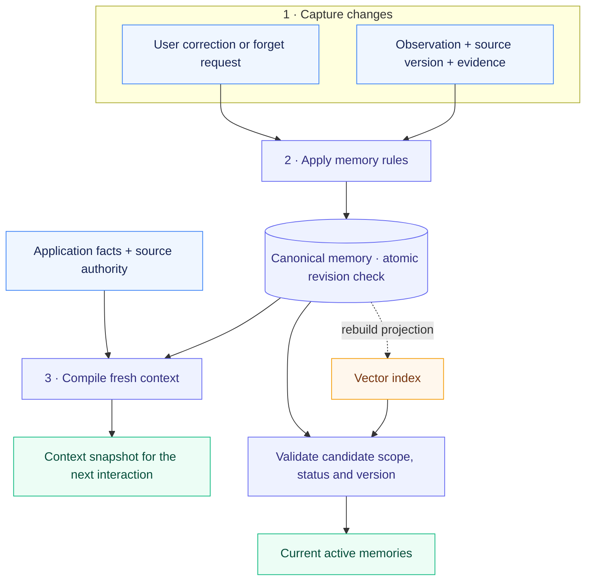

<div align="center">

# ContextKit

### Memory you can trace. Context you can correct.

Evidence-backed memory and context snapshots for stateful applications.

[](pyproject.toml)
[](CHANGELOG.md)
[](#current-limits)
[](LICENSE)
[](docs/validation.md)
[](https://github.com/Elyon0517/contextkit/stargazers)

**Like ContextKit? [Give it a star ⭐](https://github.com/Elyon0517/contextkit)**

[Quick start](#quick-start) · [How it works](#how-it-works) · [Examples](#examples) · [Architecture](docs/architecture.md) · [Contributing](CONTRIBUTING.md)

</div>

---

ContextKit keeps observations, user corrections, and current context consistent across interactions. Start locally with a **dependency-free Python core**, then add MongoDB storage, Redis caching, or your own vector index.

**No model API key. No external services needed for the core examples.**

## How it works



**Observe → version → correct or forget → compile again.** The canonical store decides what is current. Cached snapshots and vector indexes are derived views; stale vector hits are checked against the store before recall.

[Explore the architecture →](docs/architecture.md)

## Why ContextKit

A customer corrects a remembered preference. An old event arrives again. A vector index still contains the previous embedding. The next interaction needs the corrected state, with a clear record of where it came from.

| Capability | What it gives your application |
| --- | --- |
| 🔎 **Evidence-backed memory** | Source references and versions travel with each observation. |
| ✏️ **User-controlled corrections** | Explicit corrections stay protected from later inferred updates. |
| 🧹 **Forget with replay protection** | Canonical content is cleared and a tombstone blocks source replay. |
| 🔐 **Scoped state** | Tenant and subject boundaries on every memory operation. |
| 🔁 **Replay-safe mutations** | Atomic receipts and revision checks handle repeated or concurrent writes. |
| 🧭 **Fresh context snapshots** | Source authority, absent/failed states, current resource, and whole-record budgeting. |
| 🧩 **Replaceable adapters** | In-memory or MongoDB state, optional Redis cache, and a vector index contract. |

> [!NOTE]
> ContextKit is **early alpha**. Forgetting is logical revocation; physical erasure and already-running interactions have separate lifecycle requirements. See [current limits](#current-limits).

## Install

```bash
git clone https://github.com/Elyon0517/contextkit.git
cd contextkit
python -m venv .venv
source .venv/bin/activate
python -m pip install -e .
```

The distribution is named `contextkit-state`; the Python import is `contextkit`. Installation currently uses this repository.

For optional adapters and development tools:

```bash
python -m pip install -e '.[dev,mongo,redis]'
```

## Quick start

```python
from contextkit import ContextCompiler, MemoryEngine, Observation, Scope
from contextkit.adapters import InMemoryStore

store = InMemoryStore()
engine = MemoryEngine(store)
scope = Scope(tenant="helpdesk", subject="customer-42")

result = engine.observe(
    scope,
    Observation(
        event_id="message-17:preference",
        source_key="response-preference",
        source_version=1,
        content="Prefers short explanations",
        evidence=("message:17",),
        kind="preference",
        confidence=0.7,
    ),
)

corrected = engine.correct(
    scope,
    result.memory.id,
    "Prefers detailed explanations",
    evidence=("message:18",),
    expected_version=result.memory.version,
    operation_id="correction:18",
)

snapshot = ContextCompiler(store).compile(
    scope, request="Explain the refund process", resource="ticket:101"
)
assert snapshot.to_dict()["memories"][0]["user_override"]

engine.forget(
    scope,
    corrected.memory.id,
    expected_version=corrected.memory.version,
    operation_id="forget:19",
)
assert ContextCompiler(store).compile(scope).to_dict()["memories"] == []
```

The application authenticates the caller, constructs the authorized scope, and supplies real source references. Evidence references identify provenance; the library does not verify that the references support the claim. Confidence is supplied by the application and is not a calibrated probability.

## Examples

```bash
python examples/support_memory.py
python examples/source_authority.py
python examples/vector_recall.py
```

| Example | Behavior |
| --- | --- |
| [Support memory](examples/support_memory.py) | Observe, correct, replay, forget, and compile the next interaction |
| [Source authority](examples/source_authority.py) | Use authoritative facts; permit fallback on absence, block it on failure |
| [Vector recall](examples/vector_recall.py) | Reject stale index entries after correction or forgetting, then rebuild |
| [MongoDB and Redis](examples/mongo_redis.py) | Persist memory and optionally cache rendered snapshots using explicit local service URLs |

All examples use synthetic data. The vector example uses a tiny deterministic text embedder to demonstrate the contract, not retrieval quality.

## Adapters

| Role | Included implementation | Contract |
| --- | --- | --- |
| Canonical subject state | `InMemoryStore`, `MongoStore` | Atomic compare-and-swap of the complete subject aggregate |
| Snapshot cache | `InMemoryCache`, `RedisCache` | Content-addressed payloads; failures never replace canonical reads |
| Vector projection | `InMemoryVectorIndex` | Atomic scoped replacement with a monotonic projection revision |
| Embeddings | Application-supplied `Embedder` | Deterministic dimensions and model configuration per index |
| Context sources | Application-supplied `ContextSource` | Declared fact keys, authority, revision, and read status |

There is no bundled Milvus, Qdrant, or other remote vector database adapter yet. The `VectorIndex` protocol is the extension boundary; merely wrapping a remote upsert call does not satisfy its atomic replacement contract.

## Tests and checks

```bash
python -m pytest
python -m ruff check .
python -m ruff format --check .
python -m mypy
```

The default suite exercises the memory contract against the in-memory store and a MongoDB emulator, plus cache and retrieval behavior. Three live integration tests are skipped unless explicitly configured:

```bash
CONTEXTKIT_TEST_MONGO_URI=mongodb://127.0.0.1:27017 \
CONTEXTKIT_TEST_REDIS_URL=redis://127.0.0.1:6379/0 \
python -m pytest -m integration
```

Use isolated test servers. The MongoDB tests create a uniquely named test database and drop that database afterward. The Redis test removes only its generated test key. No repository-hosted automated workflows are required.

Initial release check results are recorded in [validation](docs/validation.md).

## Current limits

<details>
<summary><strong>Read the deployment and consistency boundaries</strong></summary>

- The synchronous API fits small application backends and reference integrations. Use a worker thread from an async server; an async adapter is not included.
- MongoDB stores one aggregate per subject. This makes each mutation atomic without a multi-document transaction, but is intended for bounded profiles; MongoDB's document size limit and contention constrain growth. Receipts and operations currently have no compaction.
- Forget clears the canonical content and evidence, retains a source tombstone, and excludes the record from new reads. It is **logical revocation**, not certified physical erasure. Previously returned snapshots, Redis entries until TTL, backups, and vector projections until rebuild require separate lifecycle handling.
- A read reflects state at its canonical read boundary. A later mutation cannot retract context already handed to a running interaction. Providers and memory are not read in one cross-database transaction.
- Context budgeting measures characters after escaping, not tokens. It drops whole memories first, then the lowest-authority facts. It never cuts JSON strings in half.
- Structured context is marked as untrusted data and delimiter characters are escaped. Runtime policy, tool authorization, and prompt-injection defenses remain application responsibilities.
- No automatic conversation extraction, semantic conflict resolution, task queue, distributed lease worker, model integration, or evaluation framework is included.

</details>

## Design origin

The design addresses problems encountered in stateful user-facing applications: conflicting sources, stale session context, repeated background events, and user control over inferred memory. This repository implements those behaviors independently using general-purpose contracts and synthetic examples. It contains no application-specific prompts, business assets, or production data.

## Contributing

See [CONTRIBUTING.md](CONTRIBUTING.md). Bug reports with an event sequence and expected state are especially useful. License: [MIT](LICENSE).

---

<div align="center">

**Found this useful? [Star ContextKit ⭐](https://github.com/Elyon0517/contextkit)**

[Report a bug](https://github.com/Elyon0517/contextkit/issues) · [Explore examples](examples) · [Read the contracts](docs/contracts.md)

</div>
