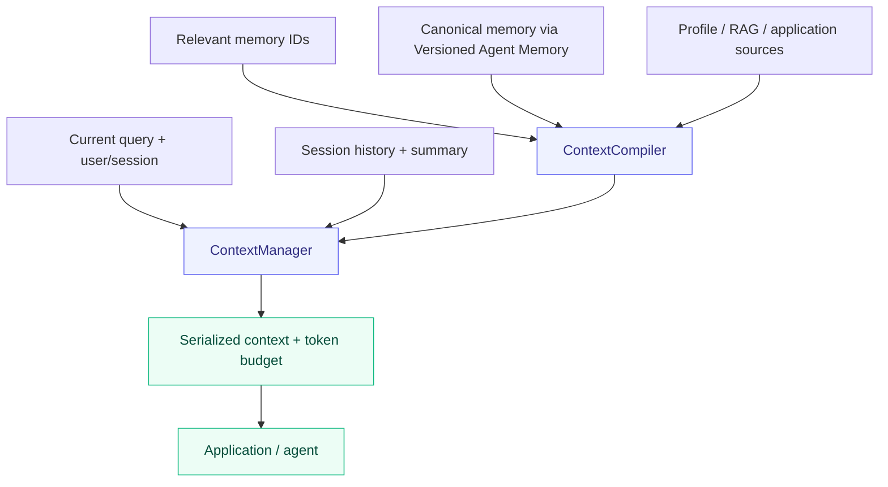

<div align="center">

# Agent Context Builder

原名 **ContextKit**。本次调整仓库名称；Python 包名、import 路径和 CLI 命令保持兼容。

**[English](README.md) · 简体中文**

### 会话有序，上下文有预算。

面向有状态应用的会话与上下文编排组件。

[](pyproject.toml) [](CHANGELOG.md) [](docs/validation.md) [](LICENSE) [](#limitations) [](https://github.com/Elyon0517/agent-context-builder/stargazers)

**喜欢这个项目？ [请点一个 Star ⭐](https://github.com/Elyon0517/agent-context-builder)**

[Architecture](docs/architecture.md) · [Examples](examples) · [Validation](docs/validation.md) · [Contributing](CONTRIBUTING.md)

</div>



## 三个独立组件

| 仓库 | 职责 |
| --- | --- |
| [Versioned Agent Memory](https://github.com/Elyon0517/versioned-agent-memory) | 长期记忆、存储、检索、会话历史与摘要状态 |
| **Agent Context Builder** | 会话上下文组装、来源仲裁与预算 |
| [Agent Strategy Eval](https://github.com/Elyon0517/agent-strategy-eval) | 独立实验与策略评测 |

Agent Context Builder 0.2 将记忆内核迁入 Versioned Agent Memory，避免重复维护。原有 `contextkit.MemoryEngine`、模型与存储 adapter 导入保留兼容性。Agent Context Builder 负责上下文编排，不执行模型或工具。

## 快速上手

需要 Python 3.11+。Git 安装会解析固定版本的 Versioned Agent Memory。当前通过 GitHub 分发，尚未发布到 PyPI。

```bash
pip install "contextkit-state @ git+https://github.com/Elyon0517/agent-context-builder.git@v0.2.0"
```

```python
from agent_memory_kit import Message, Scope, SessionMemory
from contextkit import ContextCompiler, ContextManager
from contextkit.adapters import InMemoryStore

scope = Scope("demo", "user-1")
sessions = SessionMemory()
sessions.append(scope, "chat-1", Message("m1", "user", "Plan dinner"))
manager = ContextManager(
    ContextCompiler(InMemoryStore()), sessions, count_tokens=len
)  # Demonstration character counter.
context = manager.build(
    scope, session_id="chat-1", query="Suggest a menu", max_tokens=2000, reserved_tokens=300
)
print(context.render())
```

实际 token 预算请使用模型 tokenizer 替换 `len`。计数包含完整序列化上下文；应用另外添加的 prompt、工具定义和输出空间应通过 reserved_tokens 预留。

## 当前能力

| 能力 | 行为 |
| --- | --- |
| Session context | 组合摘要及其覆盖范围之后的消息 |
| Source authority | 按声明优先级解决 profile、应用及 RAG 事实冲突 |
| Failure semantics | 高优先级来源失败时阻止低优先级事实；无记录时允许回退 |
| Retrieval bridge | 可选检索回调选择 ID；编译时重新读取权威存储中的有效记忆 |
| Budgeting | 同时应用字符与调用方 token 限制，不截断记录 |
| Provenance | 保留来源版本、证据、省略计数与内容寻址快照 |
| Cache | 可选 Redis 缓存，权威存储决定有效状态 |

不提供检索回调时考虑所有有效记忆。RAG/profile 通过 ContextSource 接入，不绑定数据库或模型供应商。检索回调的顺序不会保留，选中记忆仍按用户纠正、confidence 和 ID 排序。

## 示例

- [Session and context assembly](examples/session_context.py)
- [Source authority and failure behavior](examples/source_authority.py)
- [Compatibility memory example](examples/support_memory.py)
- [Vector retrieval](examples/vector_recall.py)
- [MongoDB and Redis](examples/mongo_redis.py)

## 当前限制

目前为 alpha，使用同步接口，会话存储驻留进程内。没有内置模型调用、agent 执行、工具生命周期或 tokenizer。各来源分别读取，不提供跨来源事务；已返回的快照无法撤回。ContextCompiler 使用字符预算，ContextManager 另使用调用方 token 计数器。

超限时依次移除摘要、较早消息、低优先级记忆与事实。若摘要被移除，已被摘要覆盖的历史消息不会重新恢复。当前 query 和结构不截断；它们自身超限时抛出 ContextBudgetExceeded。应用额外添加的 prompt/工具文本需要预留预算。记忆评分、过期和持久化边界见 [Versioned Agent Memory](https://github.com/Elyon0517/versioned-agent-memory)。

## 本地开发

```bash
python -m venv .venv
source .venv/bin/activate
pip install -e '.[dev,mongo,redis]'
pytest -q
ruff check .
ruff format --check .
mypy
```

默认测试会跳过三项真实服务集成测试。[验证记录](docs/validation.md) 说明临时 MongoDB/Redis 的测试方式和边界。

## 许可证

本项目采用 [MIT License](LICENSE)。

Copyright © 2026 Honghao Li.
