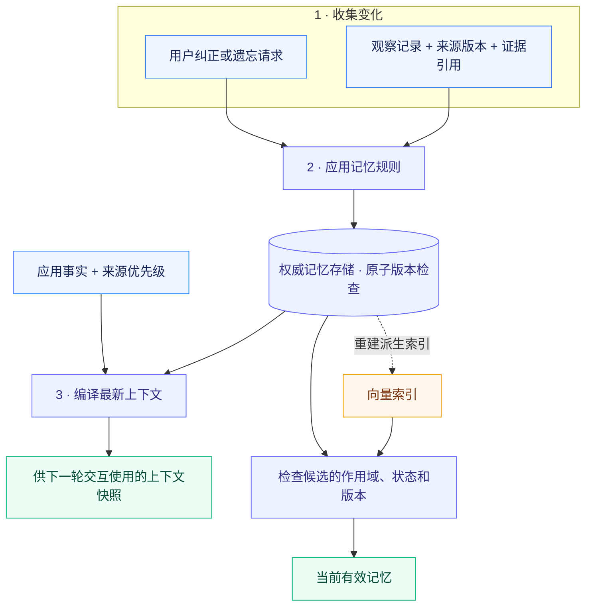

<div align="center">

# ContextKit

**[English](README.md) · 简体中文**

### 记忆有据可查，上下文可由用户纠正。

为有状态应用提供带来源证据的记忆管理与上下文快照。

[](pyproject.toml) [](CHANGELOG.md) [](#当前限制) [](LICENSE) [](docs/validation.md) [](https://github.com/Elyon0517/contextkit/stargazers)

**喜欢 ContextKit？[请给项目一个 Star ⭐](https://github.com/Elyon0517/contextkit)**

[快速上手](#快速上手) · [工作流程](#工作流程) · [示例](#示例) · [架构说明](docs/architecture.md) · [参与贡献](CONTRIBUTING.md)

</div>

---

ContextKit 让应用观察到的事实、用户纠正和当前上下文在持续交互中保持一致。从**无第三方运行时依赖的 Python 核心**开始，再按需接入 MongoDB 存储、Redis 缓存或自定义向量索引。

**运行核心示例无需模型 API 密钥，也无需外部服务。**

## 工作流程



**记录观察 → 管理版本 → 纠正或遗忘 → 重新编译上下文。** 权威存储决定哪些记忆仍然有效。缓存快照与向量索引都是派生视图；向量召回的候选必须经过权威存储校验。

[深入了解架构 →](docs/architecture.md)

## 为什么选择 ContextKit

用户纠正了一条偏好记忆，随后旧事件再次到达，而向量索引仍保存着之前的 embedding。下一轮交互需要使用纠正后的状态，并清楚地追踪其来源。

| 能力 | 为应用解决的问题 |
| --- | --- |
| 🔎 **带证据的记忆** | 每条观察记录携带来源引用与来源版本。 |
| ✏️ **用户可控的纠正** | 用户的明确纠正受到保护，后续推断不能静默覆盖。 |
| 🧹 **阻止重放的遗忘机制** | 清空权威记录中的内容，保留撤销标记，阻止同一来源被重新写入。 |
| 🔐 **作用域隔离** | 每次记忆操作都限定租户与主体，主体通常是用户。 |
| 🔁 **可安全重试的状态更新** | 将幂等凭据与记忆变更原子提交，并通过版本检查处理并发写入。 |
| 🧭 **最新上下文快照** | 区分来源优先级、无记录与读取失败，包含当前资源，并按完整记录控制长度。 |
| 🧩 **可替换的适配器** | 支持内存或 MongoDB 状态存储、可选 Redis 缓存，以及向量索引接口。 |

> [!NOTE]
> ContextKit 处于 **早期 Alpha 阶段**。遗忘属于逻辑撤销；物理清除与已经开始的交互需要额外的生命周期管理。详见[当前限制](#当前限制)。

## 安装

```bash
git clone https://github.com/Elyon0517/contextkit.git
cd contextkit
python -m venv .venv
source .venv/bin/activate
python -m pip install -e .
```

发行包名称为 `contextkit-state`，Python 导入名称为 `contextkit`。目前从此仓库安装。

安装可选适配器与开发工具：

```bash
python -m pip install -e '.[dev,mongo,redis]'
```

## 快速上手

```python
from contextkit import ContextCompiler, MemoryEngine, Observation, Scope
from contextkit.adapters import InMemoryStore

store = InMemoryStore()
engine = MemoryEngine(store)
scope = Scope(tenant="helpdesk", subject="customer-42")

result = engine.observe(
    scope,
    Observation(
        event_id="message-17:preference",
        source_key="response-preference",
        source_version=1,
        content="偏好简短的解释",
        evidence=("message:17",),
        kind="preference",
        confidence=0.7,
    ),
)

corrected = engine.correct(
    scope,
    result.memory.id,
    "偏好详细的解释",
    evidence=("message:18",),
    expected_version=result.memory.version,
    operation_id="correction:18",
)

snapshot = ContextCompiler(store).compile(
    scope, request="解释退款流程", resource="ticket:101"
)
assert snapshot.to_dict()["memories"][0]["user_override"]

engine.forget(
    scope,
    corrected.memory.id,
    expected_version=corrected.memory.version,
    operation_id="forget:19",
)
assert ContextCompiler(store).compile(scope).to_dict()["memories"] == []
```

应用负责认证调用方、构建其有权访问的作用域，并提供真实的来源引用。证据引用用于追踪来源；库本身不会验证引用是否支持该条记忆。置信度由应用提供，不是经过校准的概率。

## 示例

```bash
python examples/support_memory.py
python examples/source_authority.py
python examples/vector_recall.py
```

| 示例 | 演示内容 |
| --- | --- |
| [客服记忆](examples/support_memory.py) | 记录观察、纠正、重放、遗忘，并为下一轮交互编译上下文。 |
| [来源优先级](examples/source_authority.py) | 优先使用权威事实；无记录时允许回退，读取失败时阻止回退。 |
| [向量召回](examples/vector_recall.py) | 纠正或遗忘后过滤过期索引条目，再重建索引。 |
| [MongoDB 与 Redis](examples/mongo_redis.py) | 显式配置本地服务地址，持久化记忆，并按需缓存渲染后的快照。 |

所有示例均使用合成数据。向量示例中的小型确定性文本 embedding 实现用于展示接口行为，不代表真实语义检索质量。

## 适配器

| 职责 | 已包含的实现 | 接口约定 |
| --- | --- | --- |
| 主体的权威状态 | `InMemoryStore`、`MongoStore` | 对完整主体状态进行原子的比较并交换，即 CAS。 |
| 快照缓存 | `InMemoryCache`、`RedisCache` | 按内容摘要寻址；缓存失败不会替代权威状态读取。 |
| 向量投影 | `InMemoryVectorIndex` | 按作用域原子替换，投影 revision 单调递增。 |
| Embedding | 应用提供的 `Embedder` | 每个索引使用固定的维度与模型配置。 |
| 上下文来源 | 应用提供的 `ContextSource` | 声明事实键、来源优先级、版本与读取状态。 |

目前未内置 Milvus、Qdrant 或其他远程向量数据库适配器。`VectorIndex` 协议是扩展边界；仅封装远程 upsert 调用，不能满足原子替换约定。

## 测试与检查

```bash
python -m pytest
python -m ruff check .
python -m ruff format --check .
python -m mypy
```

默认测试套件针对内存存储与 MongoDB 模拟器检查记忆行为，同时验证缓存与召回。除非显式配置测试服务，否则三项真实服务集成测试会跳过：

```bash
CONTEXTKIT_TEST_MONGO_URI=mongodb://127.0.0.1:27017 \
CONTEXTKIT_TEST_REDIS_URL=redis://127.0.0.1:6379/0 \
python -m pytest -m integration
```

请使用隔离的测试服务。MongoDB 测试会创建名称唯一的测试数据库，并在结束后删除该数据库。Redis 测试只删除自身生成的测试键。无需添加仓库托管的自动化工作流。

版本验证结果记录在[验证说明](docs/validation.md)中。

## 当前限制

<details>
<summary><strong>查看部署与一致性边界</strong></summary>

- 当前为同步 API，适用于小型应用后端与参考集成。在异步服务中应通过工作线程调用；尚未提供异步适配器。
- MongoDB 为每个主体保存一个聚合文档，无需多文档事务即可原子更新。这适合规模受控的用户画像；文档大小限制与写入竞争会约束增长。幂等凭据与操作记录尚无压缩或清理机制。
- 遗忘会清空权威记录的内容和证据，保留来源撤销标记，并从后续读取中排除该记忆。这属于**逻辑撤销**，不等于经过认证的物理清除。已经返回的快照、TTL 到期前的 Redis 条目、备份，以及重建前的向量投影，都需要单独管理。
- 读取反映的是权威状态读取时刻的状态。之后的变更无法收回已经交给运行中交互的上下文。各来源与记忆不在同一个跨数据库事务中读取。
- 上下文预算按转义后的字符数计算，而非 token 数。优先移除完整记忆，再移除最低优先级的事实，不会从中间截断 JSON 字符串。
- 结构化上下文会标记为不可信数据，并转义分隔符字符。运行时策略、工具授权与提示注入防护仍由应用负责。
- 尚未包含自动对话抽取、语义冲突解决、任务队列、分布式租约 worker、模型集成或评估框架。

</details>

## 设计起源

这一设计针对有状态用户应用中遇到的问题：来源冲突、会话上下文过期、后台事件重复，以及用户对推断记忆的控制。仓库使用通用接口和合成示例独立实现这些行为，不包含特定应用的提示词、业务资产或生产数据。

## 参与贡献

请参阅[贡献指南](CONTRIBUTING.md)。包含事件顺序与预期状态的缺陷报告尤其有帮助。许可证：[MIT](LICENSE)。

架构、接口约定、适配器指南与贡献指南目前为英文。

---

<div align="center">

**觉得有帮助？[给 ContextKit 一个 Star ⭐](https://github.com/Elyon0517/contextkit)**

[反馈问题](https://github.com/Elyon0517/contextkit/issues) · [查看示例](examples) · [阅读接口约定](docs/contracts.md)

</div>
